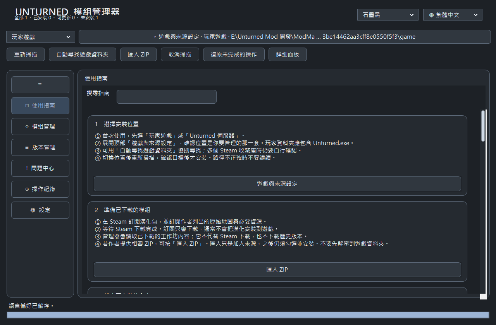

# 自動辨識手動安裝、完整指南與語言／主題修正

日期：2026-10-30。獨立分支 feature/automatic-manual-install-and-guide，從 c1055c4 延續並保留既有分支。沿用 WinForms / .NET Framework 4.8。

## 實際行為

主畫面已移除「核對／接續紀錄」按鈕。掃描會在背景辨識手動安裝，安裝／更新前再次驗證，不使用過期快取作寫入依據。

| 偵測結果 | 行為 |
| --- | --- |
| 原助手紀錄、目前內容及來源同版且相符 | 保留現有遊戲檔案與安裝紀錄，不重裝、不建立接管備份 |
| 可驗證的手動版本較新 | 保留，不自動降級 |
| 可驗證的原助手手動舊版 | 顯示舊版、目標新版及目標位置，確認後驗證並複製原助手備份，保存舊紀錄，重新預檢再更新 |
| 無助手紀錄，但完整內容與來源一致 | 唯讀辨識為符合來源的手動內容，保留，不猜測其他歷史版本 |
| 未知修改、缺備份、未完成交易、不可比較版本 | 保留內容並顯示原因，不強制通過；單一項目失敗不影響獨立項目的預檢 |
| 已由管理器正確管理並更新 | 以目前受管理檔案及備份驗證為準，避免原助手舊紀錄反過來誤判新版 |

沒有可信原助手紀錄、也找不到內容相符來源的舊版，不能可靠辨識其版本或原始備份；仍依既有衝突確認及備份流程處理，不宣稱支援任意第三方手動安裝格式。未接管的手動安裝不提供管理器解除安裝，指南說明應使用原工具還原。伺服器模式保留既有角色驗證，沒有把玩家助手紀錄套用到伺服器。

只有已確認的手動舊版更新會建立 ManualEvidence（目前內容證據）、ImportedOriginals（已驗證原備份副本）及 ReconcileHistory（先前紀錄）。同版／較新版保留不進行這些寫入。遊戲檔案寫入仍經既有安裝驗證、交易與回滾；備份及來源格式不變。本次開發未再修改使用者實際遊戲、安裝紀錄或備份。

## 十二主題指南

指南擴充為目標選擇、下載／匯入、掃描、安裝、既有手動安裝、更新、版本與來源、移除還原、備份／中斷、伺服器、啟動選項、問題與回報。每個主題提供具體步驟、限制及可操作入口。

支援標題與全文搜尋、搜尋無結果說明；中英文字依實際字體、寬度、間距及按鈕高度計算卡片高度，不再使用固定小卡加省略號。啟動選項入口實際複製 -Lang=Tchinese，不修改 Steam。三語各 466 個資源鍵一致且格式參數相符。

## 語言切換不再重設主題

已先加入測試重現「選另一個主題後切回繁中，主題被換回初始值」。原因是共用文字翻譯將 ComboBox 目前顯示值當成固定文字，依首次擷取的文字覆寫，進而觸發主題選擇。

現在一般固定文字翻譯排除 ComboBox，其選項由各自的本地化流程更新；ThemeChanged 也不接受語言重繪期間的變動。實際選擇的主題識別碼、兩個主題選單及保存偏好保持一致。

## 建置與測試

Windows build.ps1 -Test 通過共 500 項：核心 73、版本／來源 23、主題與批次 108、指南與回應速度 38、手動辨識／接續／輸入 77、三語介面 181。

測試包含四主題 × 三語、切回繁中、保存及重開；指南十二主題、三語全文量測、搜尋與無結果；同版不改寫安裝紀錄與遊戲時間、較新版不降級、無紀錄完整內容辨識、舊版更新、取消與未知內容保護、更新後仍可還原原助手備份且保留無關修改。原有啟動溢位、底部原生裁切、單項勾選、ZIP、伺服器與檔案安全測試持續通過。

詳細結果在 docs/auto-guide-theme-*-results.txt。乾淨 CI 沒有本機 metadata 資料時會少 7 項本機專屬測試。控制項預覽不是原生桌面截圖；實際 Windows 視窗裁切仍有 GetWindowRgn 檢查。未驗證其他玩家電腦、遊戲內所有翻譯或多螢幕不同 DPI。

## 主要檔案

- 新增 src/ManualInstallations.cs：唯讀偵測、舊版證據與受保護更新流程。
- 修改 src/App.cs、Batch.cs、ModernWorkflow.cs、ReconciliationUi.cs、Experience.cs：移除按鈕、掃描／版本狀態、批次與主題翻譯。
- 修改 src/Dashboard.cs 及三份 src/Resources/*.json：完整指南、搜尋及三語文案。
- 修改 DashboardTests.cs、ResponsiveTests.cs、ReconciliationTests.cs、ExperienceTests.cs：主題回歸、指南及手動安裝驗證。
- 修改 build.ps1、README.md，新增本報告與測試證據。

尚未合併正式分支或發布 Release，未上傳或更動工作坊內容。
