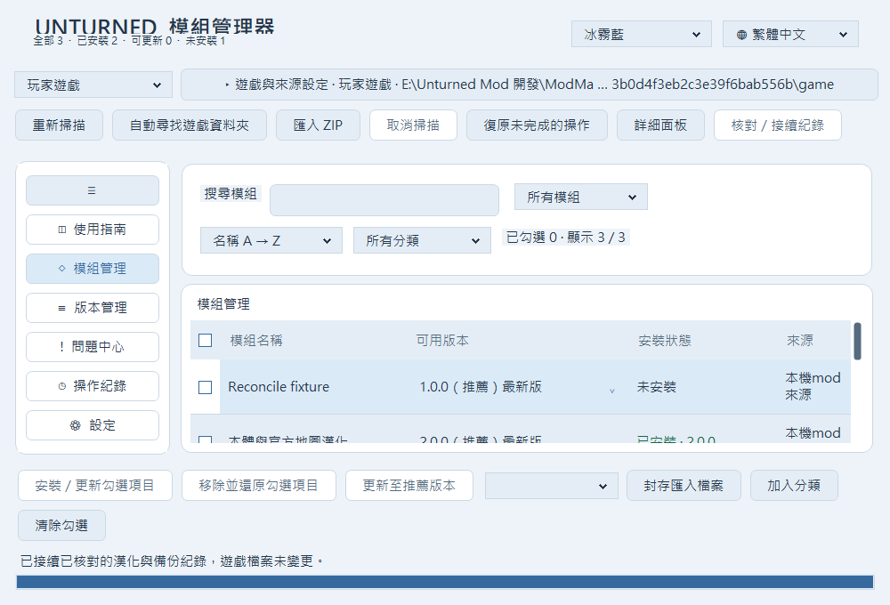
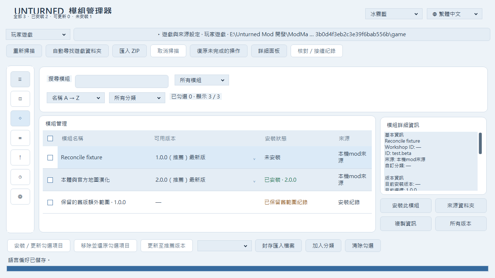

# 勾選、既有漢化紀錄接續及縮小版面驗證

日期：2026-10-30。分支：`fix/selection-and-existing-install-reconciliation`，從 `e5b0d1838286aab52a89c5255e8a6a0abf88c5be` 建立；既有工作與分支保留。沿用 WinForms / .NET Framework 4.8，未合併正式分支或發布 Release。

## 這次修改

- 修正模組及版本核取方塊無法單項勾選：自訂版本選單使用程式編輯模式，原本也阻擋了核取方塊的編輯啟動。現在以獨立滑鼠／空白鍵手勢處理核取方塊；按下及放開需在同一格，失去滑鼠捕捉會取消。保留全選、版本群組、子版本與部分選取。
- 模組頁底部操作常駐，無選取時停用不適用操作。窄視窗自動換行並調整保留高度，避免橫向捲動隱藏按鈕。
- 收合導覽從 60 加寬為 88 像素；圖示置中並保留提示，按鈕依可用高度調整，避免設定入口在底部被裁切。
- 狀態與進度改為上下兩列，進度條使用接近全視窗寬度；核對及複製備份仍在背景進行。
- 新增「核對／接續紀錄」，提供可審閱的檔案、備份、還原點與額外舊範圍數量。只有全部證據符合時才允許確認。
- 將「已被其他工具或遊戲更新修改」改為「與管理器紀錄不同、原因尚未確認」。舊操作紀錄的同類訊息也會依目前語言重新顯示，避免將紀錄不同步直接歸因於其他 Mod。
- 繁中、英文、簡中各 443 個資源鍵，含接續流程、確認、成功及錯誤提示。

## 接續的安全界線

核對所選套件重新載入後的簽章、產品識別、遊戲／工作坊目標、版本、範圍、完整路徑集合、來源與目前檔案 SHA-256，以及原安裝助手每份備份的紀錄雜湊。原助手鎖定中、任一工具有未完成交易、缺備份或任何不符都會停止。

確認後重新核對，將原助手備份複製到 `ImportedOriginals/<本次識別碼>/` 並再次驗證。既有管理器紀錄及原助手紀錄另存於 `ReconcileHistory/<本次識別碼>/`；原管理器的 hashed 備份與原助手資料保留。管理器紀錄最後才以既有原子寫入方式更新。

接續不寫入、刪除或還原遊戲檔案。新舊還原點不同時，確認畫面會明示採用原助手還原點。後續安裝、更新、交易失敗回滾及解除安裝均保留並使用獨立備份引用。

不在新套件清單內的舊紀錄另存成「保留的舊版額外範圍」，維持原雜湊及備份引用；重掃與重開後仍依紀錄顯示問題提醒。未知修改仍受原有保護，不會因接續而被當成已解決。

接續後請使用本版或更新版本還原，完整保留 ImportedOriginals 及 ReconcileHistory。舊版程式不認得新增備份引用。安裝包格式與可寫入範圍未變更。

## 目前使用者資料的唯讀核對

對本機的本體 v1.2（管理器版本 `2026.10.29.1`）及原安裝助手資料核對結果：

| 項目 | 結果 |
| --- | ---: |
| 目前檔案、來源、原助手紀錄完全相符 | 1,939 檔 |
| 原助手備份可驗證 | 1,939 份 |
| 兩工具還原點不同 | 289 檔 |
| 新套件範圍外的舊紀錄 | 1,037 條 |
| 額外舊範圍仍有內容差異 | 1 檔 |

仍有差異的相對位置為 `Bundles/Vehicles/Eagle_Germany/Tchinese.dat`。此次沒有判定其來源，也沒有改動此檔案。`EditorEnvironment.dat` 所在的新範圍已通過完整核對。

以上是唯讀預覽，沒有在使用者實際紀錄上執行接續，也沒有修改實際遊戲或備份。可用新版程式選取對應漢化、按「核對／接續紀錄」，審閱上述差異後自行確認。

## 建置與測試

Windows 內建 .NET Framework 編譯器已成功產生可執行 EXE。`build.ps1 -Test` 的六套檢查合計 **455 項**，另外以 California 2 v1.2 真實內容在隔離目標執行 **24 項**，總計 **479 項**。

| 範圍 | 通過 | 證據 |
| --- | ---: | --- |
| 原有檔案驗證、交易、衝突、安裝與還原 | 73 | docs/reconciliation-core-results.txt |
| 版本、來源快取、工作坊範圍與封存 | 23 | docs/reconciliation-workflow-results.txt |
| 四主題、名稱與批次操作 | 92 | docs/reconciliation-dashboard-results.txt |
| 指南、搜尋、進度合併、增量匯入及取消 | 29 | docs/reconciliation-responsive-results.txt |
| 實際滑鼠／空白鍵、接續、備份、並行及窄版配置 | 57 | docs/reconciliation-reconciliation-results.txt |
| 三語各頁、安裝／移除及尺寸／縮放 | 181 | docs/reconciliation-ui-results.txt |
| 真實 California 2 雙範圍與全部 3,043 檔 | 22 | docs/reconciliation-california-results.txt |
| 相同套件的測試 ZIP 匯入與全部雜湊 | 2 | docs/reconciliation-zip-results.txt |

接續測試涵蓋未知修改、備份損壞、紀錄在確認後改變、產品／目標不符、助手鎖定、雙方未完成交易、重複接續、不同還原點、舊範圍未知修改、更新失敗回滾及實際還原內容。所有寫入測試均使用假的遊戲及獨立狀態資料夾。

三語在 1000×680、1366×768 及展開／收合導覽下，全部底部及導覽按鈕都在可見範圍內；較大的視窗與 125%～200% 程式縮放也通過既有檢查。滑鼠測試會先將目標列捲入可見範圍並確認命中位置，再透過真正的視窗滑鼠訊息操作，沒有以直接設定核取值取代點擊。

本機四主題套件有 7 項使用本機地圖 metadata 的額外驗證；乾淨 CI 未必具備該資料。ZIP 是以相同現有 v1.2 套件檔案建立的測試封裝，沒有修改清單或 payload；未宣稱取得另一份官方下載 ZIP。

GitHub Windows 線上建置與全部可用測試也已通過：[Actions 驗證](https://github.com/bardliao04/Unturned-Mod-Manager/actions/runs/40926669520)。

## 修改與新增檔案

- 新增 `src/Reconciliation.cs`：紀錄證據核對、備份複製、原子接續與舊範圍保留。
- 新增 `src/ReconciliationUi.cs`：接續流程、單項核取、常駐命令換行與全寬進度。
- 新增 `src/ReconciliationTests.cs`：隔離接續、安全拒絕、實際滑鼠與三語版面驗證、唯讀核對入口。
- 修改 `src/Core.cs`：保留的範圍與備份引用，安裝／還原及錯誤相容。
- 修改 `src/App.cs`、`src/Experience.cs`、`src/ModernWorkflow.cs`、`src/Dashboard.cs`、`src/Responsive.cs`、`src/StyledControls.cs`：畫面接線、狀態、問題提醒、導覽、核取與版面。
- 修改 `src/Batch.cs`、`src/Localization.cs` 及 `src/Resources/{zh-TW,en-US,zh-CN}.json`：預檢引導、新舊訊息翻譯與三語文案。
- 修改 `src/DashboardTests.cs`、`build.ps1`、`.github/workflows/windows.yml`：新尺寸、測試入口與 CI 證據保存。
- 修改 `README.md`；新增本報告與 `docs/reconciliation-*.txt`、兩張截圖。

## 尚未驗證與後續

- 未在實際遊戲安裝上提交接續，未啟動 Unturned 或多人伺服器驗證遊戲內文字／字型。
- 1 個額外舊範圍檔案仍需人工核對；不提供強制覆蓋或清空備份的捷徑。
- 原助手紀錄格式不符、檔案集合不同或備份不足時維持停止；其他舊工具的遷移格式需另建明確核對規則。
- 未實機測試低階硬體、多螢幕不同 DPI 或程序恰於紀錄原子替換時被作業系統終止。檔案操作仍保留驗證，慢碟可能需要等待。
- 後續可加入舊範圍逐檔比對報表與更完整的助手格式轉接，繼續以證據核對及保留原備份為原則。
